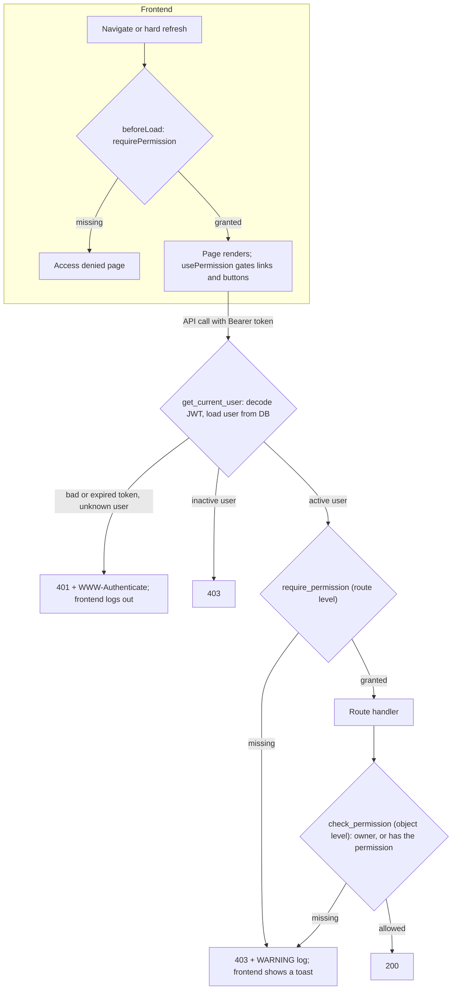

# Full Stack FastAPI Template

[](../../actions/workflows/test-docker-compose.yml)
[](../../actions/workflows/test-backend.yml)

## Role-Based Access Control

This fork adds three roles (**admin**, **manager**, **member**) to the template.
Routes require permissions, never roles, and one static map in
[`backend/app/core/permissions.py`](backend/app/core/permissions.py) decides
which role has which permission. The frontend reads the caller's computed
permissions from `GET /users/me` and gates pages, links and buttons on them.

Design decisions: [ADR 0001](docs/adr/0001-permission-based-rbac.md) (permission-based RBAC) and
[ADR 0002](docs/adr/0002-backend-computed-capabilities.md) (backend-computed capabilities).
Limitations, future work and verification notes: [NOTES.md](NOTES.md).

### Quick start

Both options seed one user per role (see the table below).

**Option A: everything in Docker** (the template default; requires Docker only):

```bash
docker compose run --rm backend bash scripts/prestart.sh   # build, migrate, seed
docker compose watch
```

Open <http://localhost:8000>. The frontend is built into the backend image and
served by FastAPI. The first build takes a few minutes. Host ports 80, 1025,
5432, 8000, 8025, 8080, 8090 and 9323 must be free. `docker compose watch` also
starts a `playwright` container that exits straight away; that's expected.

**Option B: database in Docker, app on the host** (requires Docker,
[uv](https://docs.astral.sh/uv/) and [Bun](https://bun.sh); ports 1025, 5432,
5173, 8000 and 8025 must be free):

```bash
# 1. Postgres and Mailpit
docker compose up -d --wait db mailpit

# 2. Backend: install, migrate, seed one user per role, run the API on :8000
cd backend
uv sync
uv run bash scripts/prestart.sh
uv run fastapi dev

# 3. Frontend, in a second terminal from the repository root: UI on :5173
bun install
bun run dev
```

Log in (option A: <http://localhost:8000>, option B: <http://localhost:5173>) with one of the seeded users:

| Role | Email | Password |
|---|---|---|
| Admin | `admin@example.com` | `changethis` |
| Manager | `manager@example.com` | `changethis` |
| Member | `member@example.com` | `changethis` |

The admin comes from `FIRST_SUPERUSER*`. The manager and member come from
`SEED_MANAGER_*` and `SEED_MEMBER_*` in [`.env`](.env). They are only created
when `FASTAPI_ENV=development` (set by `compose.override.yml` for option A and
by `.env` for option B), never in staging or production. Seeding is
idempotent: re-running it leaves existing users untouched.

### Running the tests

Backend (pytest). The tests aren't in the Docker image, so they run with uv
against the database from either option:

```bash
cd backend
uv sync
uv run bash scripts/tests-start.sh
```

The backend tests use the same `app` database as local development. Their
teardown removes only the users and items the tests created, so the seeded users
and your own data are kept. While one last-admin test runs, the other admins are
briefly deactivated, so avoid using the app as an admin during a test run.

End-to-end (Playwright, needs Bun and a running backend on :8000):

```bash
bun install                        # from the repository root, once
cd frontend
bunx playwright install chromium   # once
bunx playwright test               # option B: starts Vite itself if needed
PLAYWRIGHT_BASE_URL=http://localhost:8000 bunx playwright test   # option A
```

### Migration

Revision `b7e4c1d9a2f3` replaces `user.is_superuser` with `user.role`
(`VARCHAR(32)`). Existing superusers become admins and everyone else becomes a
member. **The downgrade is lossy:** only admins map back to
`is_superuser = true`, so managers come back as regular users.

### Permission matrix

Generated from `ROLE_PERMISSIONS` by
`backend/scripts/permission_matrix.py`. A test fails if this table drifts from
the code (update it with `uv run python scripts/permission_matrix.py --write`
in `backend/`).

<!-- permission-matrix:start -->
| Permission | Grants | Admin | Manager | Member |
|---|---|:-:|:-:|:-:|
| `users:read` | List users and view any user (`GET /users/`, `GET /users/{id}`) | ✓ | ✓ | – |
| `users:create` | Create users with any role (`POST /users/`) | ✓ | – | – |
| `users:update` | Update any user, including role and active flag (`PATCH /users/{id}`) | ✓ | – | – |
| `users:delete` | Delete other users (`DELETE /users/{id}`) | ✓ | – | – |
| `items:manage_all` | List, view, update and delete everyone's items (`/items/`) | ✓ | – | – |
| `metrics:read` | View usage metrics (`GET /metrics/`) | ✓ | ✓ | – |
| `system:manage` | Admin tools: test email, password-reset email preview | ✓ | – | – |
<!-- permission-matrix:end -->

Every signed-in, active user can view and update their own profile, change
their own password, and manage their own items. These need no permission.
Two rules protect the admin role itself:

- An admin can't delete their own account.
- The last active admin can't be demoted or deactivated. That request returns 409.

### Approach

**Where checks live.** Route-level checks are a FastAPI dependency:
`dependencies=[Depends(require_permission(Permission.USERS_READ))]` on the
route decorator. Some checks depend on the loaded record: someone else's
item, or another user by id. The handler makes those itself with
`check_permission(request, user, permission)`. Both raise 403 and log one
WARNING line with the user id, the permission, the method and the route
template, so path values such as an email never reach these denial logs.
The server's access log, inherited from the template, is separate and does
record full URLs (see [NOTES.md](NOTES.md#known-limitations)). A bad,
expired or unknown-user token is a 401 with `WWW-Authenticate`, and an
inactive account is a 403. Dependencies were chosen over decorators, which
don't play well with FastAPI's signature inspection, and over middleware,
which has no per-route context.

**How roles are stored and validated.** `user.role` is a `VARCHAR(32)` column
that SQLAlchemy validates against the `Role` `StrEnum`. It isn't a native
Postgres ENUM, so adding a role needs no migration. The role is read from the
database on every request, never from the JWT, so a demotion takes effect on
the user's next request. Self-service schemas (`UserRegister`, `UserUpdateMe`)
have no role field, so signup and profile edits can't set a role.

**How the frontend learns capabilities.** `GET /users/me` returns `role` (for
display) and `permissions`, which the backend computes from the same map. The
frontend never re-implements that map. `usePermission(perm)` and `can(user, perm)` take the
generated `Permission` type, so a misspelled permission fails to compile.
Routes declare `beforeLoad: requirePermission(...)`, which works on direct
navigation and on hard refresh, and render an Access denied page instead of
redirecting. A 401 logs the user out. A 403 shows a toast and keeps them
signed in.

**Adding a role.**

1. In `backend/app/core/permissions.py`, add a `Role` member and its row in
   `ROLE_PERMISSIONS`.
2. Update the README matrix: `cd backend && uv run python scripts/permission_matrix.py --write`.
3. Regenerate the client from the repository root: `bash scripts/generate-client.sh`.
4. Add the label in `frontend/src/lib/roles.ts` and the badge variant in
   `frontend/src/components/Common/RoleBadge.tsx`. Both are typed
   `Record<Role, …>`, so the build fails until they're added.

No migration, no route changes, and no other frontend changes.

### Request path



---

*The rest of this README is the original template documentation.*

## Technology Stack and Features

- ⚡ [**FastAPI**](https://fastapi.tiangolo.com) for the Python backend API.
  - 🧰 [SQLModel](https://sqlmodel.tiangolo.com) for the Python SQL database interactions (ORM).
  - 🔍 [Pydantic](https://docs.pydantic.dev), used by FastAPI, for the data validation and settings management.
  - 💾 [PostgreSQL](https://www.postgresql.org) as the SQL database.
- 🚀 [React](https://react.dev) for the frontend.
  - 🧩 Built into the backend application and served by FastAPI on the same domain as the API.
  - 💃 Using TypeScript, hooks, [Vite](https://vitejs.dev), and other parts of a modern frontend stack.
  - 🎨 [Tailwind CSS](https://tailwindcss.com) and [shadcn/ui](https://ui.shadcn.com) for the frontend components.
  - 🤖 An automatically generated frontend client.
  - 🧪 [Playwright](https://playwright.dev) for end-to-end testing.
  - 🦇 Dark mode support.
- ☁️ [FastAPI Cloud](https://fastapicloud.com) for deployment.
- 🐋 [Docker Compose](https://www.docker.com) for local services and self-hosted deployment.
  - 📞 [Traefik](https://traefik.io) as a reverse proxy with automatic HTTPS.
- 🔒 Secure password hashing by default.
- 🔑 JWT (JSON Web Token) authentication.
- 📫 Email-based password recovery.
- ✉️ [React Email](https://react.email) for email templates.
- 📬 [Mailpit](https://mailpit.axllent.org) for local email testing during development.
- ✅ Tests with [Pytest](https://pytest.org).
- 🏭 CI (continuous integration) and CD (continuous deployment) based on GitHub Actions.

### Dashboard Login


### Dashboard - Admin


### Dashboard - Items


### Dashboard - Dark Mode


### React Email Templates


### Mailpit - Local Email Testing


### Interactive API Documentation


## How to Use It

Click the **Use this template** button at the top of this page to create a new repository.

## Backend Development

Backend docs: [backend/README.md](./backend/README.md).

## Frontend Development

Frontend docs: [frontend/README.md](./frontend/README.md).

## Deployment

FastAPI Cloud deployment: [deployment.md](./deployment.md).

Self-hosted deployment with Docker Compose: [deployment-docker-compose.md](./deployment-docker-compose.md).

## Development

General development docs: [development.md](./development.md).

This includes the local FastAPI and Vite workflow, Docker Compose services, `.env` configuration, and more.

## Release Notes

Check the file [release-notes.md](./release-notes.md).

## License

The Full Stack FastAPI Template is licensed under the terms of the MIT license.
